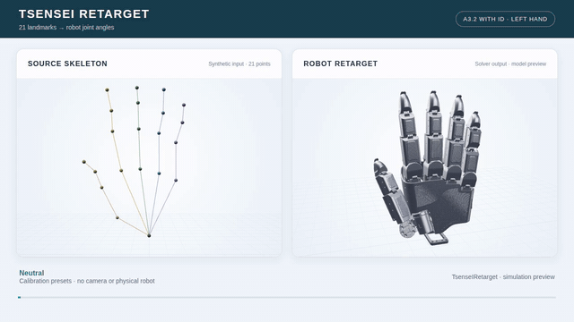

# TsenseIRetarget

TsenseIRetarget 将 MediaPipe 顺序的 21 个三维手部关键点映射为灵巧手的关节角。本仓库是面向 **TsenseI A3.2** 的源码与标定快照，包含求解器、左右手模型、标定文件和本地网页预览工具。原 TopoRetarget 的导入名称仍作为兼容别名提供。

此快照以原项目提交 `95510dd3235ac68bc15b584d031b326225928f36` 为基础，并包含打包时工作区中的改名改动；本仓库独立初始化，不包含原项目的 Git 历史。

## 效果演示

[](docs/retarget-demo.mp4)

[观看或下载 MP4 视频](docs/retarget-demo.mp4)。左侧是 21 点输入骨架，右侧是 A3.2 with ID 左手的求解结果；演示包含握拳、拇食对指和拇中对指。视频使用模型标定生成的**合成姿态**逐帧调用实际求解器，并通过项目的 3D 模型预览渲染；它不是摄像头采集或实机运动录像，也不表示实时性能。对应输入与关节角保存在 [演示数据](docs/retarget-demo-frames.json)，可用 `.venvs/track/bin/python scripts/generate_retarget_demo.py` 重新生成。

## 功能与模型

- 支持 A3.2 裸手和 A3.2 with ID，均提供左右手 URDF、网格与 21 点标定。
- 将米制 `21 × 3` 关键点转换为 20 个命名 URDF 关节角，单位为弧度；支持逐帧复用求解器状态。
- 求解结合手部拓扑、骨骼方向、指尖位置及拇指对指目标；各项参数由模型配置决定。
- 网页支持查看模型跟随、拖动骨架和标定点、使用姿态预设，以及从浏览器摄像头获取 MediaPipe 输入。
- 提供无硬件的模型、求解和标定自检。

标定文件保留原有质量状态和待复核标记。**A3.2 with ID 右手**在项目配置中标为 provisional，几何是镜像，不能视为独立实测；实际使用前应检查并调整标定。本快照未包含 A3.2 原生实机控制驱动，网页标定预览不会向机械手下发运动。

## 安装

已在 Ubuntu 24.04、Python 3.12 环境验证。Python 依赖支持 3.11–3.13；安装时需要联网。

```bash
git clone https://github.com/AGIMani/TsenseIRetarget.git
cd TsenseIRetarget
python3.12 -m venv .venvs/track
.venvs/track/bin/python -m pip install -r requirements.txt
```

本仓库附带网页使用的 Three.js、MediaPipe 浏览器运行资源和 `hand_landmarker.task`，因此仓库体积较大。浏览器需支持 WebGL；使用本地摄像头时需要授予权限。Leap Motion、RGB-D、Quest 或数据手套等输入还需要各自的设备、SDK 或连接配置。

## 网页标定与预览

```bash
bash start_calibration.sh
```

打开 <http://127.0.0.1:8766/calibration>，选择手型与左右手。页面可以编辑静态标定、拖动输入骨架或选择预设，并查看求解后的模型；也可以接入浏览器摄像头。保存会备份并更新当前工作目录中的标定 YAML，导出则下载 YAML。按 `Ctrl+C` 停止服务。

## 命令行与 Python 调用

运行一次无硬件求解：

```bash
.venvs/track/bin/python examples/retarget_a32.py --model TsenseI_v3_2_withid --side left
```

默认使用模型零位关键点。也可以添加 `--input-json points.json`，传入 MediaPipe 顺序的 `21 × 3` JSON 数组，坐标单位为米。默认输入已转换到求解器的腕部坐标系；使用 `--source-frame mediapipe` 可先执行与网页一致的输入坐标变换。输出 JSON 中的 `joint_values` 是 URDF 关节角，单位为弧度。

```python
import sys
sys.path[:0] = [".", "src"]  # 从仓库根目录运行

from hand_profiles import load_hand_profile

solver = load_hand_profile("TsenseI_v3_2_withid").create_retargeter("left")
points = solver.fk.compute()       # 示例：模型零位的 21 × 3 关键点，米
result = solver.retarget(points)
print(result.joint_values)        # 关节名 -> 弧度
```

处理连续帧时复用同一个 `solver`，以保留 warm-start 状态。求解器公开接口及参数见 [TsenseI_retargeting/README.md](TsenseI_retargeting/README.md)。

## 目录结构

```text
TsenseI_retargeting/              重定向求解器与正向运动学
assets/hands/TsenseI_hand_v3_2/    A3.2 裸手模型与标定
assets/hands/TsenseI_hand_v3_2_withid/  A3.2 with ID 模型与标定
online_control/                   网页服务、输入适配与浏览器资源
src/hand_profiles.py              模型配置加载
tools/                            标定预览、姿态预设和输入变换
examples/                         命令行求解示例
scripts/                          自检与演示数据生成
docs/                             演示视频、输入和求解结果
tests/                            自动化测试
```

## 自检

```bash
sha256sum -c MANIFEST.sha256
.venvs/track/bin/python scripts/check_bundle.py

# 可选：安装测试依赖并运行测试
.venvs/track/bin/python -m pip install pytest
.venvs/track/bin/python -m pytest -q
```

校验清单对应仓库中的文件；保存标定后，被修改的 YAML 校验值会发生变化。自检覆盖两种模型的左右手网格、21 点标定、求解与临时文件保存，不验证摄像头识别精度或实机运动。

## 第三方资源

浏览器运行资源及引用代码的版权和许可证说明见 [THIRD_PARTY_NOTICES.txt](online_control/online_motion_track/THIRD_PARTY_NOTICES.txt) 和 [vendor/realsense-hand-tracking](vendor/realsense-hand-tracking/)。
